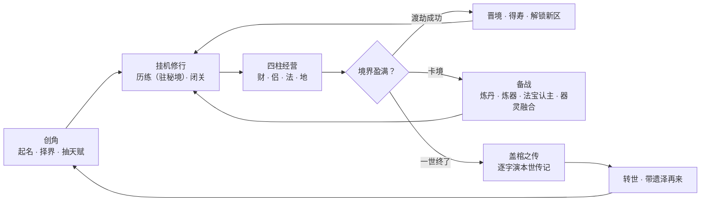
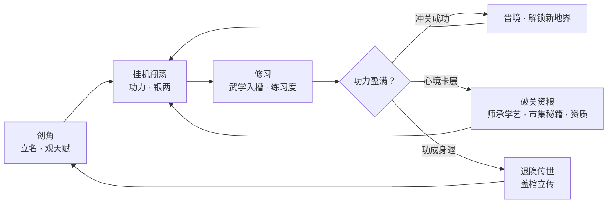

# 三千世界 · sanqian-world

一个**多世界框架**的放置人生模拟游戏，以 **x-hub 扩展**形态交付。当前两界可投生：**玄幻修仙**（放置修仙人生模拟）与**侠影江湖**（金庸语料底座的冒险放置 RPG）。创角一世 → 挂机经营 → 终局盖棺 → 转世再来。启动先经 **万界门环**（三维世界选择器）择界而入，后续世界以资料片形式持续扩展。

**零 CDN、零打包器、零框架**：全部代码是经典 `<script>` 脚本，随扩展包一起走，没有构建步骤，改完刷新即生效。

> **找文档？** 本件只是项目门面（玩家视角）。**开发 / 接手** → [`AGENTS.md`](AGENTS.md)（正典指引，第 0 件）→ [`docs/交接快照.md`](docs/交接快照.md)（现状）→ [`docs/README.md`](docs/README.md)（全卷文档索引）。全仓各 README 的分工表见 `docs/总纲/docs-归类整理规范.md` §二。

<!-- SQ:LEDGER:BEGIN readme 现行读数由 .tests/gen-ledger.cjs 生成，手改即漂；段外不参与覆盖 -->
- **现行读数**（本行由 `.tests/gen-ledger.cjs` 生成）：扩展版本 `0.6.101` · 冒烟 361 · 审计 37 关 · 常驻探针 235 断言 · 界面走查 44 篇 / 1027 断言 · 词表键 6774 · 世界名册 6 界（可见 6）。缺读数 = 「未跑」，不当 0 计。
<!-- SQ:LEDGER:END -->

## 一、一眼看懂

| 世界 | 形态 | 核心循环 |
|---|---|---|
| **玄幻修仙**（第一世界） | 放置修仙人生模拟 | 起名 → 择界 → 抽天赋 → 挂机修炼 → 渡劫证道，一世终了兵解转世、带「遗泽」再来 |
| **侠影江湖**（武侠世界） | 冒险放置 RPG | 立名创角 → 挂机闯荡赚功力银两 → 修习冲关晋境 → 拜师学艺、市集淘秘籍 → 卷入天下大事 → 功成退隐传世 |

### 玄幻修仙



一世终局五路：**飞升**（真仙叩天门）/**兵解**（化神起主动舍身）/**寿尽坐化**/**道伤崩碎**/**折寿而殒**——均走「盖棺之传」逐字演完本世传记，再入轮回。

| 玩法支柱 | 里面有什么 |
|---|---|
| **地**（空间） | 十境界 × 十秘境 + 洞天福地；词缀、域主、宝藏、探宝残片 |
| **法**（成长） | 功法四阶 + 融合自创 + 器灵、法器四槽、法宝认主 / 祭炼、炼丹炼器双轨 |
| **财**（经济） | 坊市 / 黑市 / 神秘商人 / 灵田，灵石账十路恒等式 |
| **侣**（关系） | 道友（拜访 · 赠丹 · 同贺 · 切磋）、道侣、护法、同门、跨世宿敌 |
| **命**（叙事） | 奇遇与传闻、天道问天与天象、势力宗门、成就图鉴与人生传记 |

### 侠影江湖

以金庸语料为底座的江湖（403 部武学、40 人池、70 对关系、96 奇遇 + 24 地方桥段 + 天下大事层），挂机与冒险双循环：



| 玩法支柱 | 里面有什么 |
|---|---|
| **闯荡** | 十三地推图（子场景推进 + 遭遇战 + 剧情抉择）、闯荡 / 闭关二模态、精力闸 |
| **武学** | 内功 / 兵刃 / 拳脚 / 奇门 / 轻功五装配位 · 黄玄地天四品 · 资质三轴（悟性 / 根骨 / 心性）· 秘籍三途（市集 / 研读 / 奇遇） |
| **师承** | 拜师（阵营门槛 + 引荐降档）→ 学艺 / 师门任务 / 供奉 → 辈分阶梯 → 叛门（有代价） |
| **江湖** | 天下大事（华山论剑 / 雁门关 / 黑木崖……参与四档：避免 / 旁观 / 卷入 / 主导，主导可改写这一世的江湖走向）、结交、传闻 |
| **终局** | 境界十档（不入流 → 三流 → 二流 → 一流 → 绝顶 → 宗师 → 大宗师 → 天人 → 化境 → 无招），功成可「退隐传世」盖棺立传；内伤咯血拒出、重伤寻医退隐 |

## 二、怎么跑起来

| 想干什么 | 怎么做 |
|---|---|
| **只玩游戏** | x-hub → 扩展中心 → 市场 → 搜「三千世界」（id `com.avalonlee.sanqian-world`）→ 安装启用。有 view / window / drawer 三形态 + 工作台卡片，**不需要本仓库任何文件** |
| **改代码** | x-hub →「我的扩展」→ 添加 `extensions/com.avalonlee.sanqian-world` 目录（添加即加载，改代码约 1.5 秒自动重载）。市场版与源码版**互不覆盖、各用各的档** |
| **浏览器直接预览** | 直接打开 `view/index.html`：无桥环境自动走 `localStorage` 回退。卡片形态另可用 `module/index.html` 的 `xhub-variant` 参数取 compact / standard / wide 三档 |
| **体验万界门环选界** | 直接打开 `view/worlds/index.html`：三维门环选世界（仙侠 → 主壳 / 侠影 → 3D 山河棋盘）；新世界接入 = `world-registry.js` 加一张卡（需求基线见同目录《万界门环-原型需求书》） |

运行时零外部依赖；仓库根 `package.json` 唯一声明的是界面走查用的 `playwright-core`。

## 三、怎么验收（只需 node）

| 命令 | 跑什么 |
|---|---|
| `npm test` | 无头快门禁（约 20 秒，收口必跑） |
| `npm run test:ui` | 无头 + 界面走查（需系统 Edge，数分钟） |
| `npm run test:sim` | 追加全程仿真模拟 |
| `npm run test:full` | = ui + sim |
| `npm run ledger:fix` | 把探针自打的读数刷进文档哨兵段（升扩展版本后必跑） |
| `node .tests/run-smoke.cjs` 等 | 进扩展目录逐件跑，判据看各件末行标记 |

判据 = **末行 `DOD_ALL_GREEN <件数>`**；任一子件红 ⇒ `DOD_FAILED` 且退码 1，并按 `docs/ledger.json` 的 `attrib` 打印该件的事实源、同动点与最小复现命令。**关数、件数、断言数一律看上方生成段与 [`docs/FACTS.md`](docs/FACTS.md)，本文不复制读数。**

静态审计分四组（逐关定义见 [`docs/总纲/三千世界-工程规范与验收计划.md`](docs/总纲/三千世界-工程规范与验收计划.md)）：

| 组 | 守什么 |
|---|---|
| **A 组** | 词表与代码卫生：CJK 裸字 / 键对账 / DOM id 唯一 / 孤儿键 / 写点声明集 |
| **B 组** | x-hub 平台关卡：manifest / 权限 / 零 CDN / 主题铁律 / 卡片纪律 / 桥容错 |
| **C 组** | 世界包词族契约（换世界不许改引擎） |
| **D 组** | 账本与装载：D1 读数生成化 · D2 加载顺序单源 · D3 世界专属别名封闭 · D4 唯一事实源自洽 |

## 四、仓库结构

**游戏本体只有一份**，在 `extensions/com.avalonlee.sanqian-world/` —— 宿主加载的就是这个目录，它自己就是完整的扩展根。仓库根不再复制 `assets/` 或 `manifest.json`（审计 **D4** 判红）。

```
仓库根
├── extensions/com.avalonlee.sanqian-world/   ← 唯一事实源
│   ├── manifest.json         扩展清单（id / version / 四形态 entry / moduleVariants）
│   ├── view/index.html       主入口：<script src> 顺序 = 装载序列唯一事实源
│   ├── view/*.js · ui.css     视图专属件（成就 / 日志 / 公告 / 法段 / 器段… 逐页外置，只挂 view）
│   ├── module/index.html     工作台卡片（引擎段序列必须等于 view 里 assets/ 那一段 = D2）
│   ├── assets/               引擎与数据：core.js + systems/ + worlds/（xiuxian + wuxia）+ lexicon/ …
│   ├── .tests/               回归资产：冒烟壳+十片 · 审计 · 仿真 · 探针 · 走查 · 账本工具
│   ├── DESIGN.md · icon.svg
├── docs/                     设计正典（多卷现行 + _archive 只读归档）
└── README.md / AGENTS.md / CLAUDE.md / package.json / LICENSE
```

## 五、存档与容量

| 项 | 口径 |
|---|---|
| **主档** `sanqian-state-v1` | 机制态（角色 + 本世世界态 + `meta` 跨世账本）；展示流落盘前剥离 ⇒ 不会越玩越大 |
| **侧档** `sanqian-logs-v1` | 日志 + 奇遇叙事 feed，各自带字节预算，超预算从最旧挤起 |
| **编码** | 平台（有桥）= `d1:` + base64(deflate)，走 Web 标准 `CompressionStream`；无桥预览与走查仍是明文 JSON；读端三态全收，旧档零迁移 |
| **容量线** | 红线 64KB / 触发线 56KB，量**编码后**字节；`SQ.SAVE_RED` / `SQ.SAVE_TRIGGER` 是单一事实源，测试一律读它不硬编码 |
| **玩家数据** | `.storage.json`（宿主实时存档）已被 `.gitignore` 排除，**永不入库**；离线读档用 `node .tests/storage-read.cjs`（调查件，不作容量判据） |

## 六、文档地图

`docs/` 是设计唯一正典，总索引 = [`docs/README.md`](docs/README.md)。按问题找文件：

| 想知道 | 去哪 |
|---|---|
| 现行**计数与池口径** | [`docs/FACTS.md`](docs/FACTS.md) |
| 现行**版本号**（每卷） | [`docs/VERSIONS.md`](docs/VERSIONS.md) |
| **还没做什么**（销号唯一落点） | [`docs/总纲/三千世界-代码实施任务清单.md`](docs/总纲/三千世界-代码实施任务清单.md) 的「现行未实施表」 |
| **某一批做了什么**（单账本） | [`docs/总纲/三千世界-项目设计文档.md`](docs/总纲/三千世界-项目设计文档.md) §七A |
| 工程规范 / 存档字段契约 / 断言总表 / 工作树纪律 | [`docs/总纲/三千世界-工程规范与验收计划.md`](docs/总纲/三千世界-工程规范与验收计划.md) |

## 七、多世界现状

世界名册 6 界：**2 界可投生（玄幻修仙 + 侠影江湖，均 live）+ 4 界灰显待开启**（magic / tech / urban / cthulhu，`pack: null`，不可投生）。屏上正名与工程 id、目录名分开管理——改 id 会牵动存档 `profile.worldId` 与整套词表命名空间，所以只改显示层，未启动界的改名与标签补全登记在任务清单 **N30**。未启动四界不排期、不新增跨世界字段或存档容器。

世界包契约（工程规范 §2.2）：`lexicon` / `initialState()` / `normalize(raw)` / `claim()` / 数据表 / `attributes` / `specialHooks` / `worldSystems`。通用层与视图**禁止直读世界专属全局** `SQ.XDATA`（审计 **D3** 拦，在册例外按出现次数钉死）。

## 八、给贡献者

| 规则 | 说明 |
|---|---|
| **分支流** | 所有改动先进 `dev`（`feature/xxx → dev`）；`master` 只接受 `dev → master` 的发布合并。直连 `master` 的 PR 被必需检查 **`branch-policy`** 拦下，管理员也不能直推 |
| **改前先读** | [`AGENTS.md`](AGENTS.md) 的硬规矩——每一条都对应过一次真实返工 |
| **读数不手抄** | 现行计数由 `docs/ledger.json` + 各文件 `SQ:LEDGER` 哨兵段生成；升扩展版本 = 改 `manifest.json` 一处 + `npm run ledger:fix` |
| **装载序列单源** | 新增系统 `.js` 只挂进 `view/index.html`；视图专属件走 `view/` 同目录，不进 `assets/`、不挂 `module/` |
| **历史注不改写** | 版本志与批次史只追加；升版走「卷头换新注、旧注原文推入卷末版本志最前」 |
| **仓根不留一次性件** | 调试脚本 / 备份 / 日志一律写到仓库之外（`git status` 干净不代表仓根干净） |

## 九、许可证

代码、设计文档、游戏文案与数值表全部以 **CC BY-NC-SA 4.0**（署名 — 非商业性使用 — 相同方式共享）发布；`LICENSE` 是官方英文条文全文。`SPDX-License-Identifier: CC BY-NC-SA-4.0`。

- 署名希望写成：*三千世界（sanqian-world）by avalonlee*，来源 https://github.com/AvalonLee/sanqian-world ，并注明是否修改。
- 衍生作品须用同一协议，且不得商用。需要商业授权请通过上述仓库联系作者。
- 本仓库不含第三方素材与外部服务：零 CDN、零外链、无外部字体与音视频；全部游戏文案与数值表均为原创（词表落 `assets/lexicon*` 与 `assets/worlds/*/lexicon-*.js`，审计 A1/A2/A4 钉死）。
