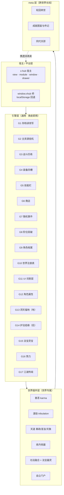
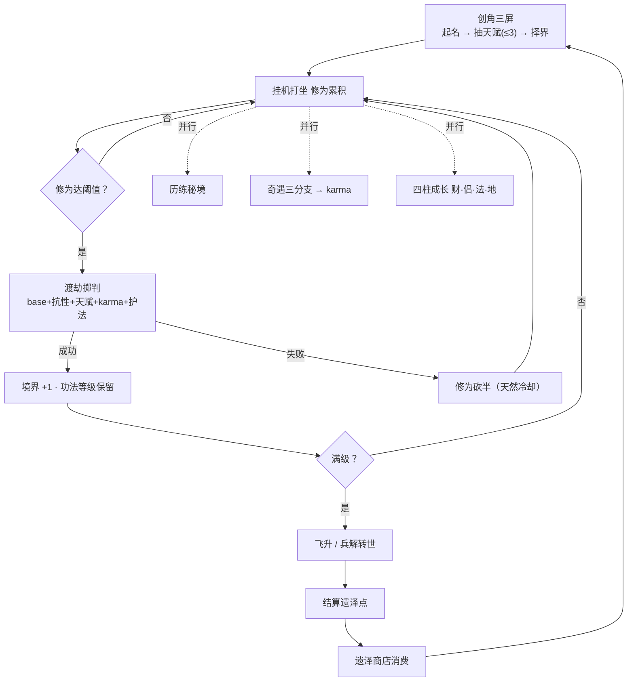
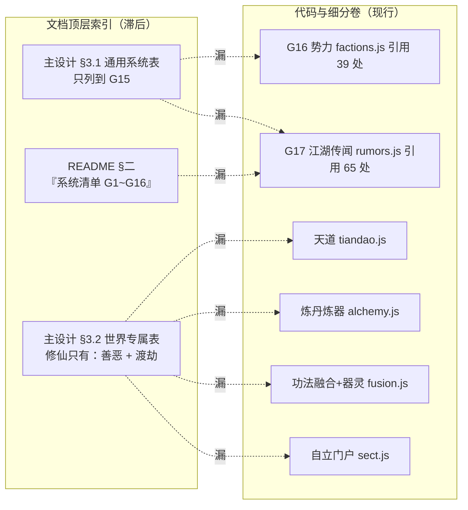
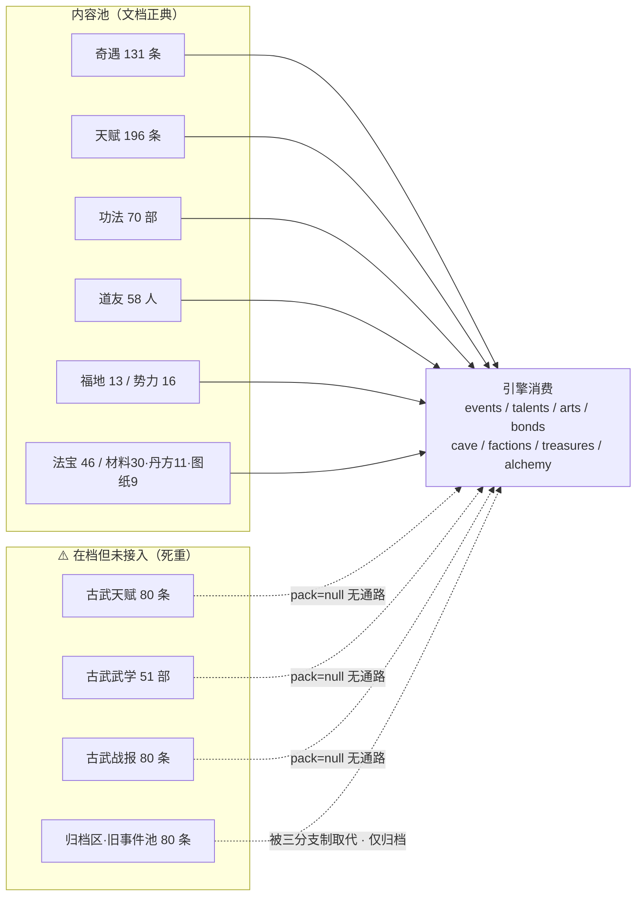
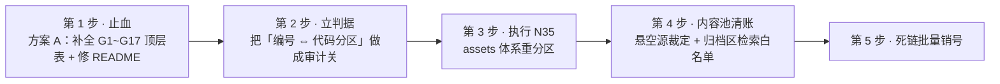

# 三千世界 · 系统全景与编号 / 内容池梳理

| 项目 | 内容 |
|---|---|
| 类型 | **过程记录档**（2026-10-22 立） |
| 口径 | ⚠️ **不立口径、不作账本**：本件内所有计数均为**当轮快照**，可能滞后；现行读数只看 `docs/ledger.json` 生成段与 `docs/FACTS.md`，现行版本只看 `docs/VERSIONS.md`，销号唯一落点仍是任务清单「现行未实施表」 |
| 用途 | 系统编号体系与内容池的**一次体检与重构提案**，供「重新梳理优化设计」决策用；不构成授权 |

---

## 一、项目定位（一句话）

**多世界放置 RPG 引擎 + 首发玄幻修仙世界**。引擎层（换皮即用）与世界观（词表包 + 专属系统插件）解耦：一个世界 = 一个内容包，不是新代码分支。当前真正可玩的是**修仙一界**，其余 5 界为 `coming`。

| 维度 | 当轮快照 |
|---|---|
| 载体 | x-hub 扩展 `com.avalonlee.sanqian-world`（经典 `<script>`，无构建） |
| 扩展版本 | `0.6.0` |
| 引擎代码 | `assets/**.js` 约 51 个文件 / 近 1.9 万行；入口 `view/index.html` + `module/index.html` |
| 世界名册 | 6 界（1 live + 5 coming） |
| 词表键 | 5023 |
| 门禁 | 冒烟 326 / 审计 34 关 / 常驻探针 245 断言 / 界面走查 35 篇 891 断言 |

---

## 二、系统全景架构（四层）

---

## 三、核心玩法循环

**三档阵营 = 三种玩法风格**（karma ±200 分界）：正道「多奇遇多掉落慢修炼」（修炼 ×0.75 / 奇遇 ×1.3）、左道「全基准」、魔道「高倍率高品质低频率」（修炼 ×1.5 / 奇遇 ×0.5 / 40% 品阶+1）。

---

## 四、分层系统清单

| 层 | 编号 | 系统 | 代码落点 | 状态 |
|---|---|---|---|---|
| 引擎 | G1 | 存档 & 读改写 | `core.js` | ✅ |
| 引擎 | G2 | 主资源挂机 | `systems/idle.js` | ✅ |
| 引擎 | G3 | 战斗历练（秘境） | `systems/combat.js` | ✅ |
| 引擎 | G4 | 装备四槽（法器） | `systems/gear.js` | ✅ |
| 引擎 | G5 | 技能栏（功法） | `systems/arts.js` | ✅ |
| 引擎 | G6 | 商店（坊市） | `systems/shop.js` | ✅ |
| 引擎 | G7 | 随机事件（奇遇） | `systems/events.js` | ✅ |
| 引擎 | G8 | 阶位/突破（境界） | `systems/realm.js` | ✅ |
| 引擎 | G9 | 角色档案 | `worlds/registry.js` + `core.js` | ✅ |
| 引擎 | G10 | 世界注册表 | `worlds/registry.js` | ✅ |
| 引擎 | G11 | UI 词表层 | `lexicon.js` + `lexicon/**` | ✅ |
| 引擎 | G12 | 角色属性（精气神） | `systems/attrs.js` | ✅ |
| 引擎 | G13 | 洞天福地（地柱） | `systems/cave.js` | ✅ |
| 引擎 | G14 | 护法结缘（侣柱） | `systems/bonds.js` | ✅ |
| 引擎 | G15 | 法宝（灵宝） | `systems/treasures.js` | ✅ |
| 引擎 | G16 | 势力 | `systems/factions.js` | ✅ |
| 引擎 | G17 | 江湖传闻 | `systems/rumors.js` | ✅ |
| 修仙 | — | 善恶系统 karma | `worlds/xiuxian/karma.js` | ✅ |
| 修仙 | — | 渡劫系统 | `worlds/xiuxian/tribulation.js` | ✅ |
| 修仙 | — | 天道（奏疏/圣旨/天象） | `systems/tiandao.js` | ✅ |
| 修仙 | — | 炼丹炼器 | `systems/alchemy.js` | ✅ |
| 修仙 | — | 功法融合 + 法宝器灵 | `systems/fusion.js` | ✅ |
| 修仙 | — | 自立门户 | `systems/sect.js` | ✅ |
| 古武 | — | 攻关晋衔 / 侠名 / 军阵 | `pack: null` | ⏸ 未接入 |
| meta | — | 轮回转世 | `systems/legacy.js` | ✅ |
| meta | — | 成就图鉴与传记 | `systems/codex.js` | ✅ |
| meta | — | 同代天骄 | `systems/prodigy.js` | ✅ |
| 支撑 | — | 事务/动作门面 | `systems/actions.js` | ✅ |
| 支撑 | — | 乘区/修正 | `systems/mods.js` | ✅ |
| 支撑 | — | 灵石总账 | `systems/ledger.js` | ✅ |
| 支撑 | — | 礼赠/好感渠道 | `systems/gifts.js` | ✅ |
| 支撑 | — | 江湖榜 | `systems/jianghu.js` | ✅ |

---

## 五、世界插件 × 词表映射矩阵

| 通用槽 | 玄幻修仙 ✅ | 三国无双 | 西方魔幻 | 科技降神 | 现代都市 |
|---|---|---|---|---|---|
| 主资源 | 修为 | 战意 | 魔力 | 算力 | 影响力 |
| 货币 | 灵石 | 军功 | 魔晶 | 数据币 | 现金 |
| 阶位 | 境界 | 军衔 | 环阶 | 权限等级 | 社会阶层 |
| 挂机 | 打坐 | 操练 | 冥想 | 挂载运算 | 打拼 |
| 战斗区 | 秘境 | 战场 | 遗迹 | 数据域 | 街区 |
| 装备四槽 | 法器 | 兵器甲胄 | 魔导器 | 义体模块 | 行头 |
| 收集灵宝 | 法宝 | — | — | — | — |
| 技能 | 功法 | 武学 | 法术 | 程序 | 技能 |
| 商店 | 坊市 | 军需处 | 魔法商会 | 交易终端 | 商场 |
| 随机事件 | 奇遇 | 战报 | 魔法异象 | 系统异常 | 突发事件 |
| 突破 | 破境 | 晋衔 | 晋阶 | 越权 | 跃迁 |
| 重生 | 转世 | 解甲 | 轮回 | 重载 | 重启人生 |
| **专属系统** | 善恶+渡劫+天道+炼丹+融合器灵+自立门户 | 攻关+侠名+军阵 | 待定 | 待定 | 待定 |

---

## 六、编号体系诊断（漂移实证）

| # | 位置 | 文档写的 | 实际 |
|---|---|---|---|
| 1 | 主设计 §3.1 | 通用系统 G1~**G15** | 已到 **G17**（势力/传闻） |
| 2 | 主设计 §3.2 | 修仙专属 = 善恶 + 渡劫 | 还有天道 / 炼丹炼器 / 融合器灵 / 自立门户 4 套 |
| 3 | README §二 | "系统清单（G1~G16）" | 应为 **G1~G17** |

**根因**：G1~G17 塞了三种粒度——① 基础设施（G1/G9/G10/G11）② 玩法循环（G2/G3/G5/G7/G8）③ 成长收集（G4/G6/G12~G17）。同一条序列里 G1 是"文件读写"、G14 是"整套结缘机制"，新系统该不该给新号没有判据 ⇒ 必然漂。

> ⚠️ 任务清单 **N35** 已登记：「`assets/systems/` 与 `assets/worlds/xiuxian/` 重分区（天道 / 炼丹 / 宗门 / 天骄 / 融合器灵**名实不符**）」——编号漂移不是没人发现，而是发现了、立了待办、未做。本件建议把 N35 升级为"编号体系重构"的总抓手。

### 重构方案对比

| 方案 | 做法 | 成本 | 风险 | 契合纪律 |
|---|---|---|---|---|
| **A. 补齐式（最小）** | §3.1 补到 G17；§3.2 补 4 套世界系统；README 改 G1~G17 | 低 | 低 | ✅ 兼容「历史注不改写」 |
| **B. 分层重编** | 拆成 B\*/G\*/C\* 三组新号 | 中 | 中——600+ 处引用要改，历史注被迫改写 | ⚠️ 与「历史注逐字不改写」冲突 |
| **C. 去编号化** | 编号降为历史锚，现行按**领域名**索引 | 中 | 低 | ✅ 与 N35 同向 |

**建议 = A + C 组合**：文档侧先做 A 止血；代码侧执行 N35 让 `systems/` 分区与文档领域分类一一对应；编号保留为引用锚，新增系统不再强制占号。

---

## 七、内容池 → 引擎消费通路（含断点）

### 重复项清单

| 类别 | 具体项 | 性质 | 现状 / 落点 |
|---|---|---|---|
| 整族悬空 | 古武天赋 80 + 武学 51 + 战报 80（共 211 条） | 在档、`pack:null`、引擎零通路 | FACTS 已注明"不含未入码的 80"；N30 待全量改名 |
| 被取代的旧池 | `_archive/专属事件池（80条）.md` | 被三分支抉择制取代 | 与现行卷同名，检索必命中旧口径 |
| 归档同名卷 | `_archive/C-体验打磨线/docs/` 下 14 份与现行正典同名 | 版本落后（如 UI v2.10 vs v2.20） | 检索陷阱；纪律 = 引用前先剔此目录 |
| 冗余落值（跨卷双写） | 四柱框架卷 ↔ 道友池卷的「结缘」行 | 同一事实两处落值 | 文档自陈"须双卷同步"，当前零漂移但结构脆弱 |
| 手抄双源（已收口） | FACTS 表格区三行手抄读数 | 同一读数两处 | N65 ✅ 已结案 |
| 同义池（设计合理） | 通用天赋池/奇遇池 vs 世界专属池 | 分层设计 | **建议不合并**，只需在索引标注清楚 |
| 池内重复集中 | 奇遇池『神秘商人』权重 12 / 冷却 1h | 权重×冷却形状失衡 | 占全池抽取 16.6%；终态在奇遇池卷 §十三.10 |
| 卷名 vs 文件名 | 古武「专属天赋池（80条）」文档写、实际文件名 `专属天赋池.md` | 整顿批纪律⑥"卷名去计数"的存量旧名 | 主设计 §文档地图仍写带计数名 |

### 死链清单

| 类型 | 具体项 | 证据 | 落点 |
|---|---|---|---|
| 写口有、读点 0 | 遗泽收支流水 `meta.karmaLog` | 4 处写口 + normalize 留 20 条 + 专门裁剪，读点 = 0 | N15 |
| 写口有、读点 0 | 榜面快照 `prodMarks.rankRows` | 视图改实时装配后零生产读点，`tick` 仍写 | N63 |
| 键没人读 | 孤儿词表键 62 key / 43 族 | A6 实测；册九十六批已按表执行（接线 5 ‖ 删 8 ‖ 留 6） | N20 ✅ |
| 交互不可达 | 功法满槽「原位替换」 | `replaceId` 分支/handler/词表全在档，入口不可达 | N14 |
| 交互缺失 | 承继选择玩家 UI | 代码自动取第一件，玩家零选择权 | N12 |
| 视图未接 | 飞升锁 `reason:'qi'` | 引擎返回该 reason，视图拼不出文案 | N13 |
| 整族无文案 | 炼制/炼器失败原因 | 直调即裸英文上屏 | N16 |
| 假在跑 | 已学会卡片精通进度条 | 槽外功法精通恒 0，进度条仍在动 | N59 |
| 同键两义 | `zone.current` 给功法槽角标 | 同一枚词键两处表达两件事 | N68 |
| 表值兜底字面量 | `X \|\| 字面量` 几十处成片 | 单源纪律隐患面 | N67 |
| 跨世断链 | 寻仇链不跨世 | `ws.revenge` 是世界位，转世即清 | N53 |
| 榜面可逆性 | `prodMarks.dead` 上限 20 < 出场 30 | 杀满 21 人后最旧死者可**重新出现在榜面** | N64 |
| 第二世界接不上 | 寿元三钩子形参比同族窄 | `lifeInfo/daoHit/daoCleanse` 直接闭包吃 D | N50 |
| 存档兼容 | 天骄好感 `ws.bonds.pr{n}` 被 normalize 剪掉 | 读档往返键整个消失 | N19 |

---

## 八、建议执行顺序

**最值得先做的三件**：① 补全顶层表 + 给编号立判据（否则必然持续漂）；② 执行 N35（一次重分区解决"名实不符"与"粒度混层"）；③ 古武三族（211 条）做一次去留裁定（全库最大的一块"在档不流通"内容）。

---

## 九、本轮已执行记录（2026-10-22）

- **第 1 步已落**（主设计 §七A 第 **170** 条）：§3.1 表补 G16/G17、§3.2 表补世界系统四套、`docs/README.md` §二索引行改 G1~G17。主设计 v2.166 → **v2.167**。
- **古武归档已落**（主设计 §七A 第 **171** 条）：`docs/古武军势/` **整目录四卷** 按用户裁定 = **原位保留 + 索引标注「⏸ 未接入 · 暂停启用」**（五处标注 = README §七 / VERSIONS §古武军势 / FACTS 武学·战报两行 / 主设计 §文档地图与 §3.2）。**文件零移动**，20+ 处引用与 `versions-check` 递归射程不受影响。主设计 v2.167 → **v2.168**。
- **校验**：`VERSIONS_IN_SYNC rows=37` ‖ `AUDIT_ALL_GREEN 34/34`（含 D9 FACTS 表结构、D4 唯一事实源）。
- **未做（后续可排期）**：N35（`assets/systems/` 与 `assets/worlds/xiuxian/` 重分区，= 编号体系的执行体）‖ 编号体系重组（分层重编 / 去编号化，本件 §六方案 B/C）‖ 内容池死链批量销号（本件 §七 清单）。
